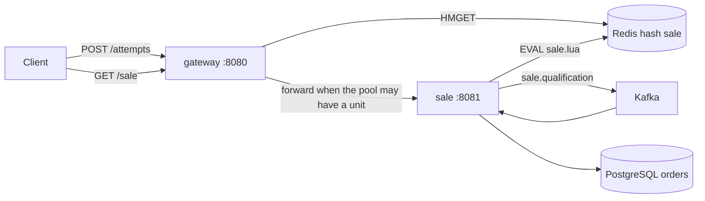
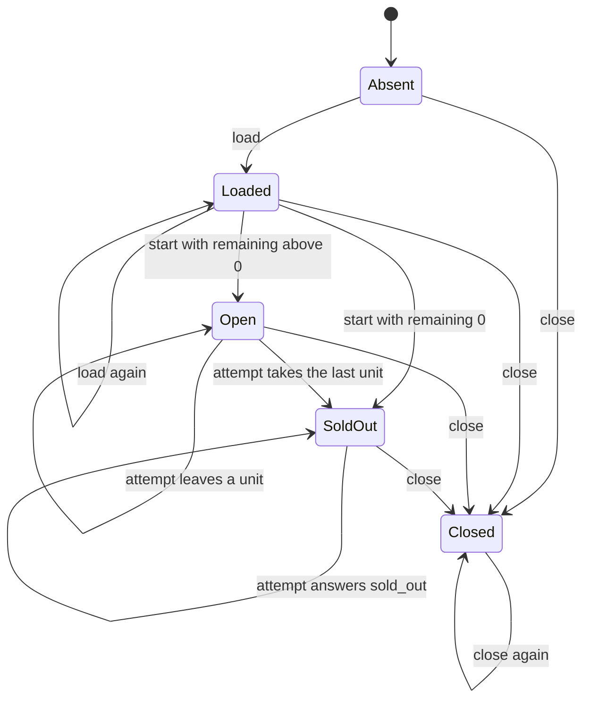
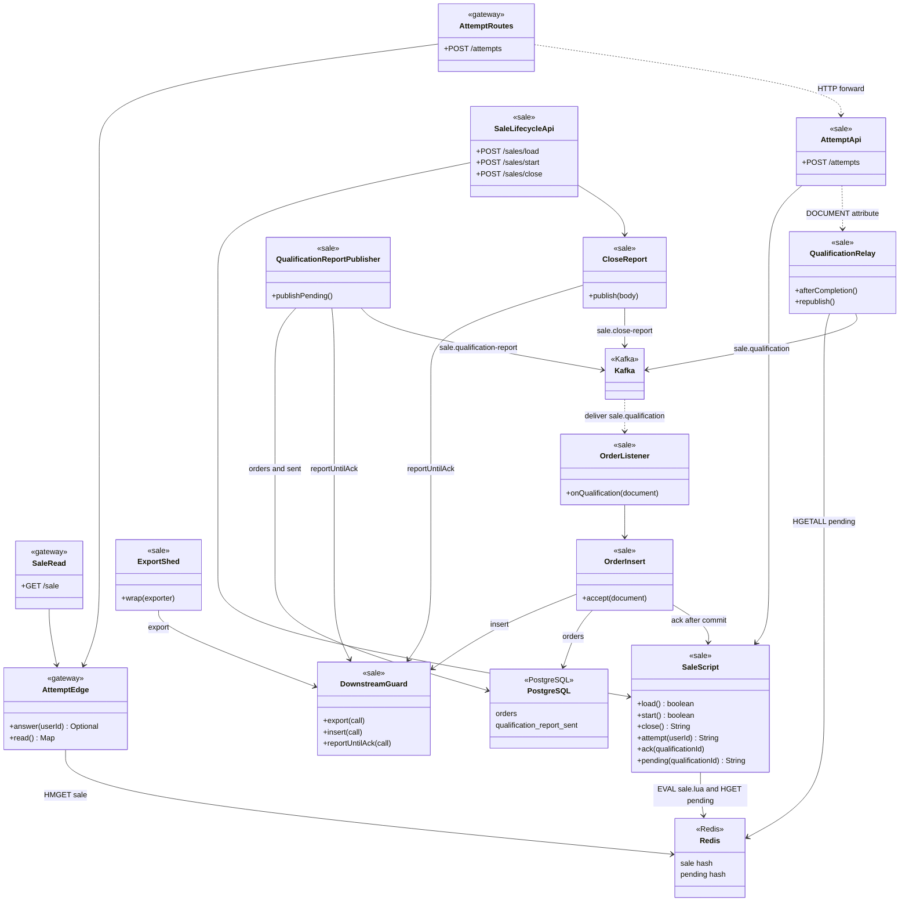
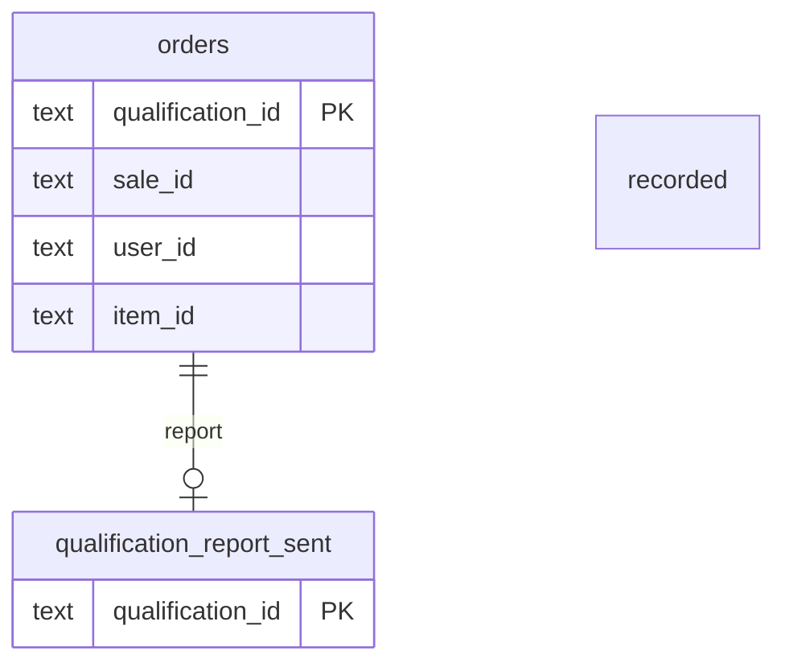
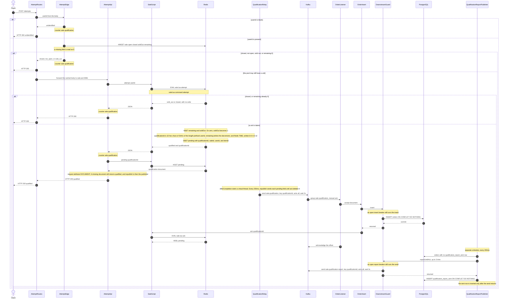

# Flash sale

A local learning model of a seckill sale. About 100,000 attempts arrive within minutes for a pool of 100 units. The sale answers each attempt at once, takes at most one unit per qualified attempt, and writes one order per qualification after the answer has gone back.

There are no accounts, no payment, and no shopper page. A unit taken at qualification is not returned if payment never finishes.

## Technology

| Piece | Choice |
| --- | --- |
| Language | Java 21 with virtual threads |
| Applications | Spring Boot 4.1.1, Gradle. `gateway` on port 8080, `sale` on port 8081 |
| Edge | Spring Cloud Gateway (servlet) |
| Pool | Redis 8.10.2. One Lua script decides every attempt |
| Broker | Apache Kafka 4.3.1. Topics `sale.qualification`, `sale.qualification-report`, `sale.close-report` |
| Orders | PostgreSQL 18.6. Flyway owns the schema |
| Breaker | Spring Cloud Circuit Breaker with Resilience4j. It never wraps the pool decrement |
| Telemetry | OpenTelemetry Collector, Prometheus, Grafana |
| Tests | JUnit with Testcontainers. JaCoCo fails `sale` or `gateway` below 95% line or branch coverage |



The gateway answers `not_open`, `closed`, `sold_out`, and `unidentified` from the Redis hash without running the script. Only an attempt that could still take a unit is forwarded. The script decrements and stores the qualification document in the same execution. Kafka carries that document to the order consumer, which inserts one row per qualification id.

`GET /sale` is that same hash read for a caller that is not attempting. `SaleRead` calls `AttemptEdge.read`, which returns `open`, `closed`, `soldOut`, and `remaining`. A missing field is `0`. The call does not choose an attempt answer, forward to sale, or run the script, and `remaining` is unchanged.

## Diagrams

### Sale states

The hash `sale` holds `itemId`, `allotment`, `remaining`, `soldOut`, `open`, `closed`, and, after the first close, `closeRemaining`. `load` and `start` apply only while `open` and `closed` are both `0`. A second load in that window replaces the allotment. `close` applies in every state. The first close stores `closeRemaining`. A later close returns that stored count.

Sold out means an open sale whose attempts answer `sold_out`. That is `remaining` of `0`, or `soldOut` of `1`. The flag becomes `1` in the attempt that decrements the last unit. A sale started with allotment `0` already answers `sold_out`, and the flag is still `0`.



### Classes

`AttemptEdge` reads the hash with `HMGET` and either answers or lets the route forward. `SaleScript` is the caller of `EVAL sale.lua`, which is the decrement. After the response, `QualificationRelay` publishes the `pending` hash to `sale.qualification`. `OrderInsert` writes the order, then acks. `QualificationReportPublisher` and `CloseReport` publish the other two topics. `ExportShed` runs span and log export through the same guard.

Each breaker uses a window of 4 calls, opens at a 50 percent failure rate, and stays open for 30 seconds. Export times out at 2 seconds. A failed, timed-out, or open-breaker export is dropped. Insert and report time out at 5 seconds, and an open breaker still runs those calls.



### Records

`pending` is a Redis hash. The field is the qualification id. The value is JSON with `qualificationId`, `saleId` (the literal `sale`), `userId`, and `itemId`. `ack` deletes that field after the order row commits. Both PostgreSQL primary keys are that same qualification id. A second delivery leaves the existing order row in place. The sent row is inserted once, after the report send returns.



### One attempt

`POST /attempts` on the gateway. The order insert and the qualification report run after the HTTP response. The listener commits `orders` before `ack` deletes the pending field. Producer sends use `acks=all`. The offset is acknowledged only after `accept` returns. A failed accept is retried every 200ms with no attempt limit.



## HTTP

| Call | Where | Body | Result |
| --- | --- | --- | --- |
| `POST /attempts` | gateway 8080 | `{"userId"}` | Always HTTP 200. `answer` is `qualified`, `sold_out`, `not_open`, `closed`, or `unidentified`. A qualified answer also has `qualificationId` |
| `GET /sale` | gateway 8080 | | The sale hash, read without the script |
| `POST /sales/load` | sale 8081 | `{"itemId","allotment"}` | 200 applied, 400 blank item or negative allotment, 409 already open or closed |
| `POST /sales/start` | sale 8081 | `{}` | 200 applied, 409 refused |
| `POST /sales/close` | sale 8081 | `{}` | 200 with `saleId`, `itemId`, and `remaining`. A second close returns the same count |

Redis keys, fields, and incident reads are in [docs/devops/README.md](docs/devops/README.md).

## Run locally

```bash
docker compose up -d
./gradlew :sale:bootRun
./gradlew :gateway:bootRun
```

Kafka UI is `http://localhost:8088/`. Grafana is `http://localhost:3000/` and opens on the Sale dashboard. Prometheus is `localhost:9090`. The collector receives OTLP at `localhost:4318`. PostgreSQL is `localhost:5432`, database, user, and password `flashsale`.

```bash
./gradlew test
```

The tests start their own PostgreSQL, Kafka, and Redis through Testcontainers, so Docker has to be running.

## Alerts

Prometheus loads the rule group `seckill.rules` from [`prometheus/seckill.rules.yml`](prometheus/seckill.rules.yml). There is no Alertmanager. Read alerts at `http://localhost:9090/alerts`.

| Alert | Fires when | Severity |
| --- | --- | --- |
| `HighQueueDepth` | Consumer lag on topic `sale.qualification`, summed over partitions, stays above 50000 for 30s | `critical` |
| `RedisHitRateLow` | Among `sold_out` and `closed` answers, the gateway's share stays below 0.99 for 60s | `warning` |

Both apps push metrics every 10s. `./gradlew prometheusRules` runs `promtool check rules` and `promtool test rules` in Docker, and `check` depends on it. Details are in [docs/devops/README.md](docs/devops/README.md#alerts).

## Burst

`./gradlew jmeterBurst` runs Apache JMeter 5.6.3 against a running sale and gateway. It is not part of `test` or `check`. It loads an allotment of 100, starts the sale, sends 100,000 attempts through the gateway, and passes only when 100 attempts qualified and those 100 ids each have one order row within two minutes.

It needs an empty `sale` hash, an empty `pending` hash, and an empty `orders` table. Before downloading or starting JMeter, it fails if `orders` or `pending` still holds rows from an earlier sale. A sale that is still loaded fails with load 409 before any attempt. The task never deletes anything.

### Reset between bursts

> **Destructive. Local learning sale only.** A reset deletes the sale, its unacknowledged qualifications, and every order row. Never point it at production or at a shared database. In a real sale those rows are customers' orders, and the pending hash is the only copy of qualifications not yet written as orders.

`./gradlew jmeterReset -PconfirmReset=local` deletes the Redis hashes `sale` and `pending` and truncates `orders` and `qualification_report_sent` on `localhost`. Without `-PconfirmReset=local` it refuses and changes nothing. It is not part of `jmeterBurst`, `test`, or `check`.

The same reset by hand:

```bash
docker compose exec redis redis-cli DEL sale pending
docker compose exec postgres psql -U flashsale -d flashsale -c "TRUNCATE orders, qualification_report_sent;"
```
