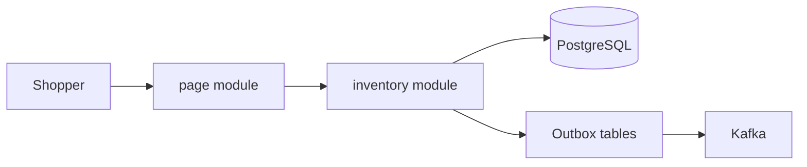
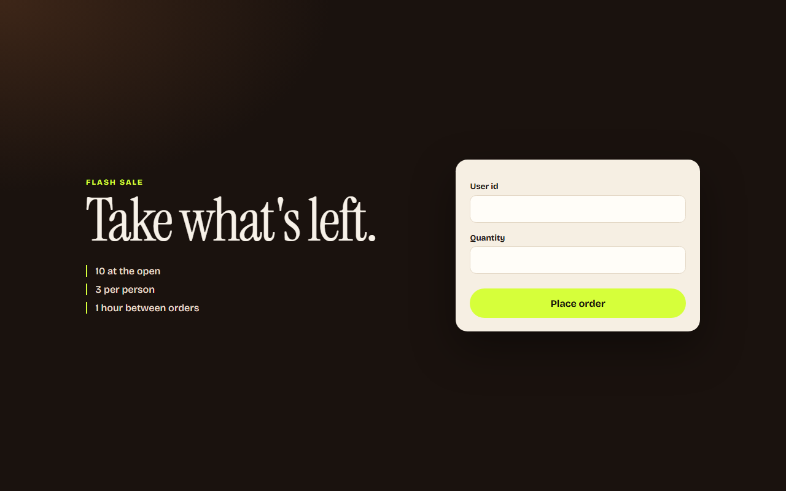
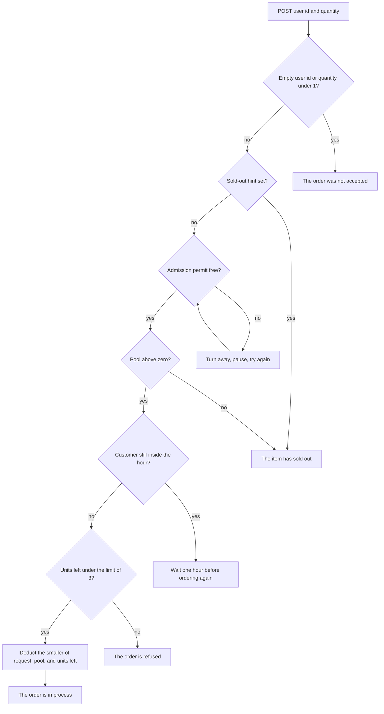
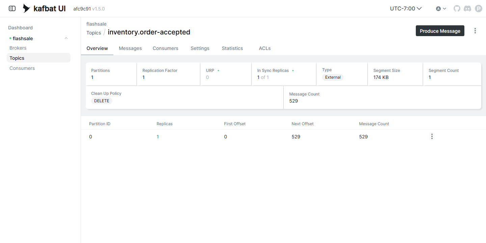
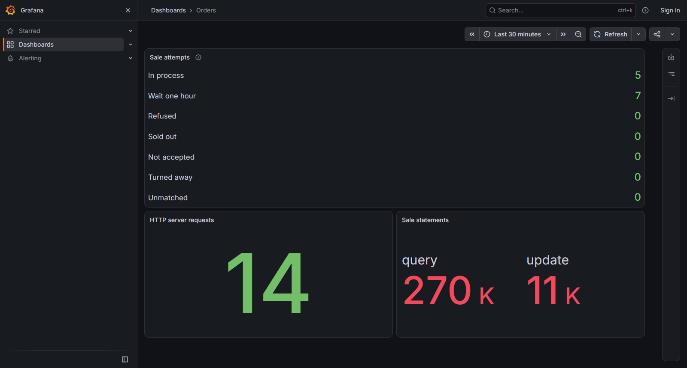

# Flash sale inventory

A local inventory service for one item. Many people can try to buy a limited quantity at once. The earliest successful orders take the units that are still available. Nobody is charged a unit that was not there, and one customer cannot successfully order more than 3 units.

This service does not take payment, fulfill the item, or create accounts. On a successful order it deducts the units and publishes an order event. Another service would complete the purchase.

## Technology

The Spring Boot application runs on the host. Docker Compose runs PostgreSQL, Kafka, Kafka UI, the OpenTelemetry Collector, Prometheus, and Grafana. PostgreSQL is `localhost:5432`, Kafka is `localhost:9092`, Kafka UI is `localhost:8088`, the collector receives OTLP at `localhost:4318`, Prometheus is `localhost:9090`, and Grafana is `localhost:3000`.

| Piece | Choice |
| --- | --- |
| Language | Java 17 |
| Application | Spring Boot 4.1.1, Gradle |
| Web | Spring MVC and a Thymeleaf form on `GET /` and `POST /` |
| Modules | Spring Modulith 2.1.1. `page` may call `inventory`. `inventory` does not call `page`. |
| Database | PostgreSQL 18.6. Flyway owns the schema. Hibernate does not change it. |
| Events | Transactional outbox through Namastack JDBC. Spring Modulith externalizes in outbox mode to Kafka. |
| Broker | Apache Kafka 4.3.1. Topic `inventory.order-accepted`, one partition. |
| Tests | JUnit via `./gradlew test`, against the Compose PostgreSQL and Kafka. JaCoCo fails that run below 95% line coverage or 95% branch coverage |

Modules:



`page` renders the form and retries only when inventory turns an attempt away. `inventory` opens the transaction, decides the order, and writes the outbox row in that same transaction. Kafka is sent after the commit.

## Business use case

A shopper already has an account. This service recognizes them by the user id they type. It does not look the account up.

The form asks for a user id and a quantity. It does not name an item. Inventory always reads the seeded row `item-1`, which starts at quantity 10.



The shopper sees one of these sentences:

| Situation | Sentence |
| --- | --- |
| Units were deducted | The order is in process |
| Same customer orders again within one hour, and the pool is still above zero | Wait one hour before ordering again |
| The pool could cover the request, but this customer has already ordered 3 units | The order is refused |
| The pool is empty, including during the wait | The item has sold out |
| The user id is empty, or the quantity is less than 1 | The order was not accepted |

Units deducted are the smaller of the quantity asked for, the units still in the pool, and the units that customer has left under the limit of 3. A short pool of at least 1 is accepted for that smaller number, so the customer keeps their place. A request the pool could cover, but that would pass the limit, is accepted for the units left. Zero units left is a refusal. Sold out wins over the wait. A sold-out attempt does not start the wait.

The one-hour wait starts when an order succeeds, not at the opening of the sale. It is stored on the customer row from PostgreSQL's clock.

A successful order writes one JSON event. The Kafka key is `orderId`. The value has exactly these fields:

```json
{"orderId":"<uuid>","userId":"<typed id>","itemId":"item-1","unitsDeducted":1}
```

`unitsDeducted` is the number subtracted, not the number requested.

### How one order is decided



A turn-away is not a shopper sentence. The page waits and tries again. The first attempt is not delayed.

## Concurrency and traffic

The scarce resource is one item row. Every successful order updates that row. The design keeps that contention inside the database and limits how many transactions can pile onto it.

**Admission.** At most `flashsale.admission.bound` attempts hold a permit. The local setting is 2, so a test can fill it. A refusal takes no database connection and is not shown as sold out. The page retries with a random pause of 10 to 50 milliseconds, and only after a turn-away. The retry has no upper bound: a full gate holds the request thread until a permit is free. That protects the database and spends request threads instead.

**The deduction.** Inventory locks the customer row, then the item row. The pool changes only with a conditional update:

```sql
UPDATE item
SET quantity = quantity - :units
WHERE id = :itemId AND quantity >= :units
```

Zero rows means the units were no longer there. The transaction rolls back, including any customer write, and no order event is stored. The stock count is the database column. There is no cache in front of it.

**Sold-out hint.** After a statement shows the pool is not above zero, later attempts can be answered from memory, before a permit and before a transaction. The hint is not a count and is never used to deduct. The product does not clear it. A later restock would still be answered as sold out until the process restarts.

**Outbox and latency.** The order event is inserted in the same transaction as the deduction. The page already has "The order is in process" when `place` returns. Kafka is sent after commit by the outbox publisher, which polls on a short fixed interval, on the order of a couple of seconds. A broker delay does not change the shopper sentence. A failed send leaves the outbox row, and the publisher retries. The shopper-visible latency is the database transaction plus admission wait, not the Kafka round trip.

**Database pressure.** The bound caps concurrent inventory transactions, and each of those holds the item row only for the decision and the update. Connections beyond the bound never open a transaction for that attempt. The publisher keeps polling, so `sale.statements` moves even when nobody is ordering. Flyway and test SQL are not counted in those totals.

**What the counters are for.** Inventory records `sale.attempts` and `sale.statements`. Every attempt that reaches inventory counts, including a turn-away. Opening the form does not. The counts reset when the process restarts. They are not success by themselves: a sale is a success only when no deducted unit was unavailable and no customer passed 3.

**What this setup does not cover.** One process on one host. No second JVM, no hosted environment, no restock, and no production choice for the admission number. Two processes would split the sold-out hint and the admission bound while sharing one database.

## Run locally

```bash
docker compose up -d
./gradlew bootRun
```

Open `http://localhost:8080/`, enter a user id and a quantity, and submit. Grafana is `http://localhost:3000/`. Kafka UI is `http://localhost:8088/`. It is already connected to this broker. PostgreSQL is `localhost:5432`, database `flashsale`, user `flashsale`, password `flashsale`. Kafka is `localhost:9092`. The collector receives OTLP at `localhost:4318`. Prometheus is `localhost:9090`. Those values are for this local Compose file.

```bash
./gradlew test
```

The tests use that same PostgreSQL and Kafka. Compose needs to be up. JaCoCo runs with the tests and fails the build when line coverage or branch coverage is under 95%. The HTML report is `build/reports/jacoco/test/html/index.html`.

## Kafka UI

Open `http://localhost:8088/ui/clusters/flashsale/all-topics/inventory.order-accepted`. The cluster `flashsale` is already connected. No bootstrap address to type.

That page is the topic `inventory.order-accepted`. Overview shows one partition. Messages shows the records. The key is `orderId`. The value is the order JSON: `orderId`, `userId`, `itemId`, and `unitsDeducted`.



## Follow one order

Place one successful order and read the same trace id in three places. Grafana shows the sale counters and the HTTP request count for that run.

Start this before you submit. It waits for the next order event. `traceparent` begins with `00-` and the same trace id. The span id in that header is a child of the console span, so the two span ids differ. The JSON body is still `orderId`, `userId`, `itemId`, and `unitsDeducted`.

```bash
docker compose exec kafka /opt/kafka/bin/kafka-console-consumer.sh --bootstrap-server kafka:19092 --topic inventory.order-accepted --partition 0 --offset latest --max-messages 1 --formatter-property print.headers=true --formatter-property print.key=true
```

Submit a user id and a quantity at `http://localhost:8080/`. The shopper sentence is "The order is in process". The console line for that order includes `trace_id` and `span_id`.

Wait a few seconds after the page returns. The order span is exported in a batch, so it is not in the collector log the instant the page comes back. Then the collector log prints that trace id on the span named `http post /`:

```bash
docker compose logs otel-collector
```

Spans named `task outboxProcessingScheduler.process` are the publisher poll. They are not the order.

Open `http://localhost:3000/`. The Orders dashboard is already there. Sale attempts lists every ending by name: In process, Wait one hour, Refused, Sold out, Not accepted, Turned away, and Unmatched. In process is a successful deduction. A zero means that ending has not happened since the process started. Sale statements reads `sum by (kind) (sale_statements_total)`. The HTTP server requests panel stays under its own title and is not that tally. Those numbers can take about a minute to move. They are not a separate series for one trace id.


