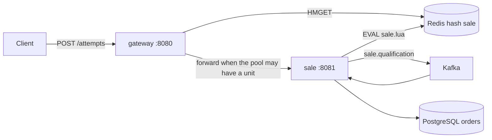

# Flash sale

A local learning model of a seckill sale. About 100,000 attempts arrive within minutes for a pool of 100 units. The sale answers each attempt at once, takes at most one unit per qualified attempt, and writes one order per qualification after the answer has gone back.

There are no accounts, no payment, and no shopper page. A unit taken at qualification is not returned if payment never finishes.

## Technology

| Piece | Choice |
| --- | --- |
| Language | Java 21 with virtual threads |
| Applications | Spring Boot 4.1.1, Gradle. `gateway` on port 8080, `sale` on port 8081 |
| Edge | Spring Cloud Gateway (servlet) |
| Pool | Redis 8.10.2. One Lua script decides every attempt |
| Broker | Apache Kafka 4.3.1. Topics `sale.qualification`, `sale.qualification-report`, `sale.close-report` |
| Orders | PostgreSQL 18.6. Flyway owns the schema |
| Breaker | Spring Cloud Circuit Breaker with Resilience4j. It never wraps the pool decrement |
| Telemetry | OpenTelemetry Collector, Prometheus, Grafana |
| Tests | JUnit with Testcontainers. JaCoCo fails `sale` or `gateway` below 95% line or branch coverage |



The gateway answers `not_open`, `closed`, `sold_out`, and `unidentified` from the Redis hash without running the script. Only an attempt that could still take a unit is forwarded. The script decrements and stores the qualification document in the same execution. Kafka carries that document to the order consumer, which inserts one row per qualification id.

## HTTP

| Call | Where | Body | Result |
| --- | --- | --- | --- |
| `POST /attempts` | gateway 8080 | `{"userId"}` | Always HTTP 200. `answer` is `qualified`, `sold_out`, `not_open`, `closed`, or `unidentified`. A qualified answer also has `qualificationId` |
| `GET /sale` | gateway 8080 | | The sale hash, read without the script |
| `POST /sales/load` | sale 8081 | `{"itemId","allotment"}` | 200 applied, 400 blank item or negative allotment, 409 already open or closed |
| `POST /sales/start` | sale 8081 | `{}` | 200 applied, 409 refused |
| `POST /sales/close` | sale 8081 | `{}` | 200 with `saleId`, `itemId`, and `remaining`. A second close returns the same count |

Redis keys, fields, and incident reads are in [docs/devops/README.md](docs/devops/README.md).

## Run locally

```bash
docker compose up -d
./gradlew :sale:bootRun
./gradlew :gateway:bootRun
```

Kafka UI is `http://localhost:8088/`. Grafana is `http://localhost:3000/` and opens on the Sale dashboard. Prometheus is `localhost:9090`. The collector receives OTLP at `localhost:4318`. PostgreSQL is `localhost:5432`, database, user, and password `flashsale`.

```bash
./gradlew test
```

The tests start their own PostgreSQL, Kafka, and Redis through Testcontainers, so Docker has to be running.

## Alerts

Prometheus loads the rule group `seckill.rules` from [`prometheus/seckill.rules.yml`](prometheus/seckill.rules.yml). There is no Alertmanager. Read alerts at `http://localhost:9090/alerts`.

| Alert | Fires when | Severity |
| --- | --- | --- |
| `HighQueueDepth` | Consumer lag on topic `sale.qualification`, summed over partitions, stays above 50000 for 30s | `critical` |
| `RedisHitRateLow` | Among `sold_out` and `closed` answers, the gateway's share stays below 0.99 for 60s | `warning` |

Both apps push metrics every 10s. `./gradlew prometheusRules` runs `promtool check rules` and `promtool test rules` in Docker, and `check` depends on it. Details are in [docs/devops/README.md](docs/devops/README.md#alerts).

## Burst

`./gradlew jmeterBurst` runs Apache JMeter 5.6.3 against a running sale and gateway. It is not part of `test` or `check`. It loads an allotment of 100, starts the sale, sends 100,000 attempts through the gateway, and passes only when 100 attempts qualified and those 100 ids each have one order row within two minutes.

It needs an empty `sale` hash, an empty `pending` hash, and an empty `orders` table. Before downloading or starting JMeter, it fails if `orders` or `pending` still holds rows from an earlier sale. A sale that is still loaded fails with load 409 before any attempt. The task never deletes anything.

### Reset between bursts

> **Destructive. Local learning sale only.** A reset deletes the sale, its unacknowledged qualifications, and every order row. Never point it at production or at a shared database. In a real sale those rows are customers' orders, and the pending hash is the only copy of qualifications not yet written as orders.

`./gradlew jmeterReset -PconfirmReset=local` deletes the Redis hashes `sale` and `pending` and truncates `orders` and `qualification_report_sent` on `localhost`. Without `-PconfirmReset=local` it refuses and changes nothing. It is not part of `jmeterBurst`, `test`, or `check`.

The same reset by hand:

```bash
docker compose exec redis redis-cli DEL sale pending
docker compose exec postgres psql -U flashsale -d flashsale -c "TRUNCATE orders, qualification_report_sent;"
```
