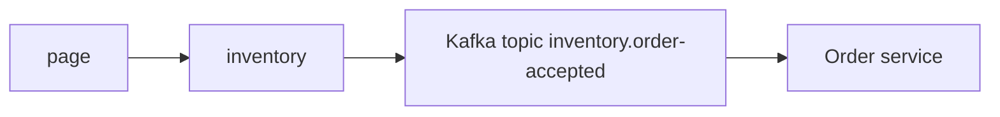
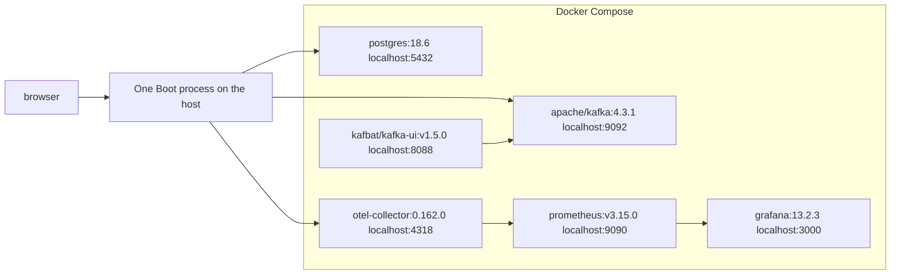
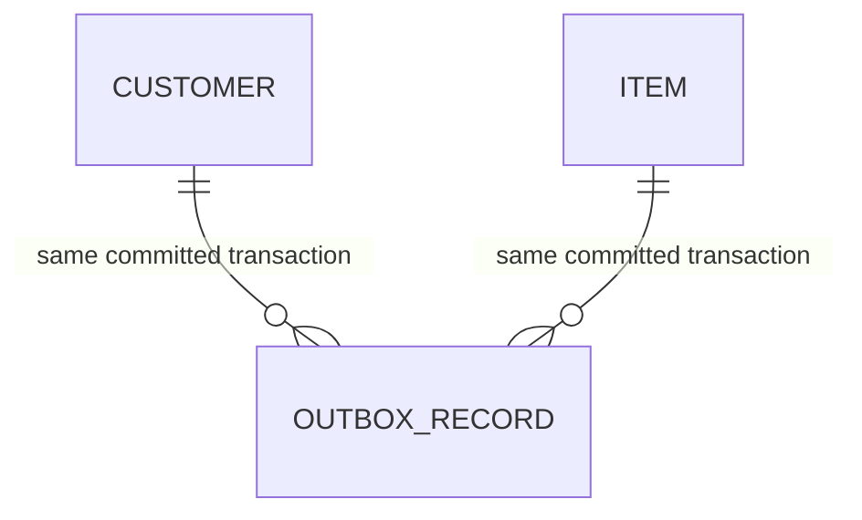
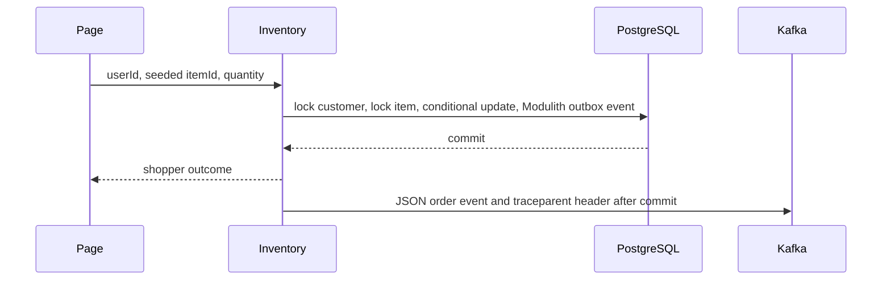

# Architecture Spine — Flash-sale inventory

## Design Paradigm

Transactional outbox. The inventory module commits the deduction and the order-event row in one PostgreSQL transaction. Spring Modulith externalization mode `outbox` sends that row to Kafka after the commit. The page module renders the outcome the inventory module returns. It does not decide, publish, or open a database transaction.

## Invariants & Rules



### AD-1 — Outbox commit [ADOPTED]

- **Binds:** inventory module, order event
- **Prevents:** a deduction with no order event, an order event with no deduction, and a second outbox row for the same deduction
- **Rule:** The inventory entry point opens and commits one PostgreSQL transaction. The page does not start a transaction around that call. A successful order publishes one Modulith event inside that transaction, and that publish is the only outbox write. Application code does not insert into outbox tables. The event, the pool update, and the customer-row update commit together. The send to Kafka happens after that commit and after the outcome has been returned to the page. A broker delay does not change the shopper outcome. If the conditional update changes no row, the transaction rolls back, including any customer insert or customer update in that transaction, and no outbox row remains.

### AD-2 — Module direction [ADOPTED]

- **Binds:** page module, inventory module
- **Prevents:** a controller deducting inventory, the inventory module importing page types, and the page issuing database statements
- **Rule:** The inventory module owns the conditional update, the customer and item rows, the admission gate, and outbox publication. The page module depends on the inventory module and only renders the outcomes inventory returns. The inventory module does not depend on the page module. The page module runs no database statements.

### AD-3 — Pool mutation [ADOPTED]

- **Binds:** FR-1, FR-3, FR-4, FR-5, FR-6, SM-C1
- **Prevents:** two requests deducting the same remaining units, a deduction during the one-hour wait, or a deduction past the customer limit of 3
- **Rule:** After the customer row is locked, and before the item update, read that row's successful units and next-allowed time. Then lock the item row and read the pool. When the pool is not above zero, the outcome is sold out, the transaction rolls back, and no outbox row is written. When the pool is above zero and the next-allowed time is still in the future, the outcome is the one-hour wait, with no pool change and no outbox row. When the pool is above zero, the customer is not in the wait, and no units are left under the limit of 3, the outcome is refused, with no pool change and no outbox row. Otherwise the units are the smaller of the requested units, the pool just read, and the units left on the locked customer row. The pool changes only by a conditional update that matches the seeded item id and only when the row still holds those units. On that match, the same transaction updates the locked customer row. A quantity that is not a positive integer matches nothing and writes no outbox row. If the conditional update changes no row while the pool is still above zero, recompute the smaller-of under the locks already held and retry the update. That miss is not sold out.

### AD-4 — Admission and response order [ADOPTED]

- **Binds:** FR-2, FR-3, the high-volume contention requirement
- **Prevents:** a connection storm on the item row, a second count of available units, sold-out shown while the pool is above zero, first-request jitter, and a deadlock from opposite lock order
- **Rule:** Only a bounded number of order attempts open a transaction on the item row. The rest are turned away with no transaction. The page does not render that turn-away. It retries the attempt with jitter until inventory returns a shopper outcome from AD-7. An attempt still waiting is not sold out while the pool is above zero. Jitter applies only to that retry. The only record of units still available is the item row's pool. A sold-out hint may answer later attempts without a transaction only after a statement has shown the pool is not above zero. The hint is not a count and is not used to deduct. Any transaction that locks both rows, including a read, locks the customer row and then the item row. A check that only needs the item row does not then lock the customer row.

### AD-5 — Order event [ADOPTED]

- **Binds:** inventory module, the separate order service
- **Prevents:** the order service decoding another format, fulfilling a different quantity, or opening a second purchase for the same order id
- **Rule:** The topic is `inventory.order-accepted`. Inventory is the only producer. The order id is generated inside the AD-1 transaction, stored in that commit, and never reused, including after a restart. It is a unique opaque string and the Kafka message key. The value is UTF-8 JSON with exactly these properties and no envelope: string `orderId`, string `userId`, string `itemId`, and integer `unitsDeducted`. `unitsDeducted` is the number of units the successful conditional update subtracted. Publication is at-least-once through `spring-modulith-events-kafka`. There is no schema registry. The order service treats `orderId` as an idempotency key and does not open a second purchase for it. Payment, fulfillment, and the original requested quantity are absent. The Kafka record also carries the W3C `traceparent` header as text. `tracestate` is present only when the propagator emits it. Those headers are not JSON properties. `io.namastack:namastack-outbox-observability` `1.7.3` stores the active W3C context on the outbox record when the event is scheduled inside the order request, and restores a child span on the outbox worker before the send. `spring-modulith-events-kafka` sends through the single `KafkaTemplate`. `spring.kafka.template.observation-enabled=true` makes that template write `traceparent` from the restored span. Application code does not add the trace header through a second producer, a producer interceptor, or `EventExternalizationConfiguration.headers`. The send runs after the AD-1 commit and stays in the same trace as the order request. A new root trace for the send is not allowed.

### AD-6 — Customer row [ADOPTED]

- **Binds:** FR-3, FR-4, FR-5
- **Prevents:** a per-order history, an application clock, two rows for one user id, and a customer list loaded before anyone can order
- **Rule:** Flyway creates the customer table with a unique key on user id. One row stores the units that customer has successfully ordered and the earliest time they may order again. User id and item id compare as exact strings, with no trim and no case fold. A blank user id is rejected before a transaction, inserts no customer row, and uses the not-accepted outcome in AD-7. When an admitted transaction finds no row, it inserts one row for that user id before it locks the item row. If that insert conflicts, the transaction locks the existing row and continues. It does not insert a second row. A successful order writes the units and the next-allowed time in the AD-1 transaction. The next-allowed time is PostgreSQL's clock plus one hour. A new customer row starts at zero units ordered, and its next-allowed time is null. Null is not a future wait. A successful order adds the units deducted to the stored total. It does not replace that total. The page does not compute the wait.

### AD-7 — Landing page [ADOPTED]

- **Binds:** page module, FR-1 through FR-6
- **Prevents:** a second client deducting inventory, a second HTTP order API, a second item id, and a rendered outcome that is not the one inventory returned
- **Rule:** The same Boot application serves one Thymeleaf form. That form is the only HTTP route that submits an order. The shopper enters a user ID and a positive integer quantity. The page does not embed an item id. It submits the item id the inventory module reads from the single seeded item row. The controller calls the inventory module in-process and does not start a database transaction. The user ID is an opaque account id. This application does not authenticate it and does not store a user table. Inventory alone applies AD-3. The page renders the returned outcome and does not replace it. Shopper outcomes are only: in process, wait one hour, sold out, refused, and not accepted. Not accepted is the outcome for a non-positive quantity or a blank user id. It deducts nothing and sends no event. The page shows that the order was not accepted.

### AD-8 — Sale counts [ADOPTED]

- **Binds:** SM-1, SM-2, SM-C1
- **Prevents:** a second tally in the page, a counter table on the hot path, a second `MeterRegistry` or an OpenTelemetry Meter beside Micrometer, these meter ids registered outside the inventory module, a log line that prints these counter values, two different database totals for the same statements, a user id or an order id on a sale meter, and an HTTP or JDBC auto-metric standing in for these meters
- **Rule:** The inventory module alone records sale business metrics on the single Micrometer `MeterRegistry` from AD-11. Both instruments are counters. `sale.attempts` has one attribute, `result`. One `admit` increments it once, with exactly one of these values: `in_process` when `place` has returned that outcome, `wait` for the one-hour wait, `refused` for a refusal, `sold_out` for sold out including the hint, `not_accepted` for a blank user id or a non-positive quantity, and `turned_away` when the admission gate turns the attempt away, and `unmatched` when `place` returns the null-message miss. No other `result` value is used. Opening the page without ordering does not increment it. The request total is the sum of `sale.attempts`. A success is `result=in_process`. That increment happens after `place` returns and before `admit` returns. It does not wait for the Kafka send. `sale.statements` has one attribute, `kind`, whose value is `query` or `update`. Every database statement from inventory JDBC and from the outbox publisher increments it, including statements that change zero rows. A `SELECT` is `query`. An `INSERT`, `UPDATE`, or `DELETE` is `update`. The counters live in process memory in the one process from AD-10. They reset when that process restarts. Request volume and database activity are not the goal by themselves. The counters do not make a sale successful. A deducted unit that was not in the pool, or a customer above the limit of 3, fails SM-C1. The application log does not print the values of these counters.

### AD-9 — Schema ownership [ADOPTED]

- **Binds:** inventory module, PostgreSQL
- **Prevents:** Hibernate generating schema, and a hand-copied outbox DDL drifting from Namastack
- **Rule:** Flyway creates and changes the item and customer tables. The customer table has the unique user-id key from AD-6. The item table has one seeded row, and the conditional update matches that row's id. A Flyway migration inserts that item and its starting pool. The inventory module uses JDBC for those rows. Namastack's JDBC starter creates the outbox tables. Flyway does not create them. Application code does not write them except through the Modulith publish in AD-1. Hibernate does not create or alter schema.

### AD-10 — Local topology [ADOPTED]

- **Binds:** the whole service
- **Prevents:** two host processes, one configuration using Compose service names while another uses localhost, and a second deployed environment in this build
- **Rule:** This spine has one environment and one Boot process on the host. Docker Compose runs `postgres:18.6`, `apache/kafka:4.3.1`, `kafbat/kafka-ui:v1.5.0`, `otel/opentelemetry-collector:0.162.0`, `prom/prometheus:v3.15.0`, and `grafana/grafana:13.2.3`. PostgreSQL is `localhost:5432`, database `flashsale`, user `flashsale`, password `flashsale`. Kafka is advertised and reached at `localhost:9092`. Kafka UI is `localhost:8088` and reaches the broker at `kafka:19092`. The host application still uses `localhost:9092`. Compose creates the topic `inventory.order-accepted` before the application publishes. The collector receives OTLP HTTP at `localhost:4318`. Prometheus is `localhost:9090`. Grafana is `localhost:3000`. Compose service names are `kafka`, `kafka-ui`, `otel-collector`, `prometheus`, and `grafana`. Kafka UI reaches the broker as `kafka`. Prometheus scrapes `otel-collector:8889`. Grafana's datasource is `http://prometheus:9090`. The Boot process uses the localhost addresses. Compose services call each other by service name. `localhost` inside a Compose container is that container. Application configuration does not use Compose service names.

### AD-11 — Signal export [ADOPTED]

- **Binds:** the host Boot process, the collector, Prometheus, Grafana
- **Prevents:** a second metrics registry, a second trace exporter, a second log appender, an export by a protocol other than OTLP, a custom sale-totals log interval, a Grafana sale panel that uses the HTTP server request timer as the sale tally, Grafana reading a store this Compose file does not run, and a collector failure changing the shopper outcome
- **Rule:** The host process uses `spring-boot-starter-opentelemetry` and `micrometer-registry-otlp` on the Spring Boot 4.1.1 BOM. Metrics export is `management.otlp.metrics.export.url=http://localhost:4318/v1/metrics`. Trace export is `management.opentelemetry.tracing.export.otlp.endpoint=http://localhost:4318/v1/traces`. Log export is `management.opentelemetry.logging.export.otlp.endpoint=http://localhost:4318/v1/logs`. This local environment sets `management.tracing.sampling.probability=1`. Logs go through `io.opentelemetry.instrumentation.logback.appender.v1_0.OpenTelemetryAppender` from `opentelemetry-logback-appender-1.0` `2.26.0-alpha`, which declares OpenTelemetry API `1.60.1`. Spring Boot 4.1.1's managed OpenTelemetry `1.62.0` wins for `io.opentelemetry` artifacts. A newer appender that requires OpenTelemetry `1.66.0` is not used. `OpenTelemetryAppender.install` runs on the Boot `OpenTelemetry` bean. `logback-spring.xml` keeps the console appender. The pattern reads `%X{traceId}` and `%X{spanId}` and prints those values under the labels `trace_id` and `span_id`. It does not read MDC keys named `trace_id` or `span_id`. AD-8's counters are the sale tally on that metrics export. The OTLP metrics export step stays at the Spring Boot default. After that export, Prometheus names them `sale_attempts_total` and `sale_statements_total`, with labels `result` and `kind`. That is the same naming this path already uses for the HTTP timer, `http_server_requests_milliseconds_count`. Grafana's provisioned sale panels query those two series. The HTTP server request timer keeps its own name and is not the sale tally. The console log does not print those counter values. A collector failure does not add a log fallback for them. Trace correlation stays on the request span, the console pattern's `trace_id` and `span_id`, and the Kafka `traceparent` header. The collector config receives the three OTLP signals. Its metrics pipeline exports on `0.0.0.0:8889` for Prometheus to scrape. The collector's own telemetry does not use that port. Traces and logs go to the debug exporter with `verbosity: detailed`, so the collector log contains the order's trace id. A slow or unavailable collector does not change the shopper outcome or whether the order event is sent. Grafana's datasource is Prometheus. That datasource and the dashboard for the sale metric are files Compose mounts into Grafana. A person opens Grafana to look and does not create the connection by hand. Tempo and Loki are not in this Compose file. When they are added, their Grafana connections are files of the same kind.

## Consistency Conventions

| Concern | Convention |
| --- | --- |
| Naming | Modulith modules are `inventory` and `page`. The topic is `inventory.order-accepted`. JSON properties are `orderId`, `userId`, `itemId`, `unitsDeducted`. |
| Data and formats | Order id, user id, and item id are exact opaque strings. Units are integers. The one-hour deadline uses PostgreSQL's clock. |
| State and cross-cutting | Customer limit is 3. Shopper outcomes are the AD-7 set. Sale counts are the AD-8 counters. Trace context is W3C `traceparent` on the Kafka record and Micrometer MDC keys `traceId` and `spanId` on the log. No account store. |
| Build | Gradle Groovy, the current Spring Initializr default. The Spring Boot parent coordinate is `4.1.1`. The generator token `4.1.1.RELEASE` is not a Maven Central coordinate. Dependencies are the stack table. Initializr's Modulith checkbox and Kafka checkbox are not substitutes for `spring-modulith-starter-namastack` and `spring-modulith-events-kafka`. |

## Stack

| Name | Version |
| --- | --- |
| Java | 17 |
| Spring Boot | 4.1.1 |
| Spring Modulith | 2.1.1 |
| spring-modulith-starter-namastack | 2.1.1 |
| namastack-outbox-starter-jdbc | 1.7.3 |
| spring-modulith-events-kafka | 2.1.1 |
| spring-kafka | 4.1.1 |
| spring-boot-kafka | 4.1.1 |
| spring-boot-starter-webmvc | 4.1.1 |
| spring-boot-starter-jdbc | 4.1.1 |
| spring-boot-starter-thymeleaf | 4.1.1 |
| spring-boot-starter-flyway | 4.1.1 |
| flyway-database-postgresql | 12.4.0 |
| org.postgresql:postgresql | Spring Boot 4.1.1 BOM |
| PostgreSQL | 18.6 |
| Docker image postgres | 18.6 |
| Apache Kafka | 4.3.1 |
| Docker image apache/kafka | 4.3.1 |
| Docker image kafbat/kafka-ui | v1.5.0 |
| Kafka UI | 1.5.0 |
| Docker image otel/opentelemetry-collector | 0.162.0 |
| Docker image prom/prometheus | v3.15.0 |
| Prometheus | 3.15.0 |
| Docker image grafana/grafana | 13.2.3 |
| Grafana | 13.2.3 |
| spring-boot-starter-opentelemetry | Spring Boot 4.1.1 BOM |
| micrometer-registry-otlp | Spring Boot 4.1.1 BOM |
| opentelemetry-logback-appender-1.0 | 2.26.0-alpha |
| namastack-outbox-observability | 1.7.3 |

## Structural Seed







```text
src/main/java/<application>/
  inventory/          # deduction, gate, customer and item rows, outbox event
  page/               # Thymeleaf form and outcome rendering
src/main/resources/
  db/migration/       # Flyway: item, customer, unique user id, item seed
  templates/          # landing page
  logback-spring.xml  # console pattern plus OpenTelemetry log appender
compose.yaml          # postgres, kafka, kafka-ui, otel-collector, prometheus, grafana
otel-collector-config.yaml
```

## Capability → Architecture Map

| Capability / Area | Lives in | Governed by |
| --- | --- | --- |
| Place an order, FR-1 through FR-6 | inventory module | AD-1, AD-3, AD-4, AD-6 |
| Landing page | page module | AD-2, AD-7 |
| Order event to other services | inventory outbox, then Kafka | AD-1, AD-5 |
| Request and database counts, SM-1, SM-2, SM-C1 | inventory Micrometer counters | AD-8, AD-11 |
| Metrics, traces, and exported logs | host process to the local collector | AD-8, AD-10, AD-11 |
| Schema | Flyway and Namastack JDBC | AD-6, AD-9 |
| Local run | one host process and Compose | AD-10, AD-11 |

## Deferred

- Admission-gate concurrency number. Turn-away stays a retry signal, not a shopper outcome. Revisit the number when a load run shows connections queueing on the item row.
- Order-id text format. The id is already unique, stored in the commit, and never reused. Revisit the character format only inside the inventory module.
- Starting pool quantity. It lives only on the seeded item row. Revisit when that Flyway migration is written.
- Exemplars that jump from a sale counter to a trace. Revisit when Grafana shows traces. Tempo is still the store for that.
- HTTP path of the form. Revisit inside the page module.
- Process supervision, health checks, and alerting on an outbox row that has not been published. The row remains until publish, and the publisher retries. Revisit when the process is no longer started by hand.
- A hosted environment. Revisit when a launch target exists.
- Tempo, Loki, and a hosted log aggregator. Revisit when Grafana itself must show traces and logs. Grafana does not store either signal. Tempo stores traces and Loki stores logs. Their Grafana connections and panels are files Compose mounts, the same way as the Prometheus datasource, and a person opens Grafana to look. Until then the collector debug exporter is the trace and log view, and the console pattern is what a hosted aggregator would parse.
- Restock, and clearing the sold-out hint. Revisit only if the pool can increase after it hits zero.
