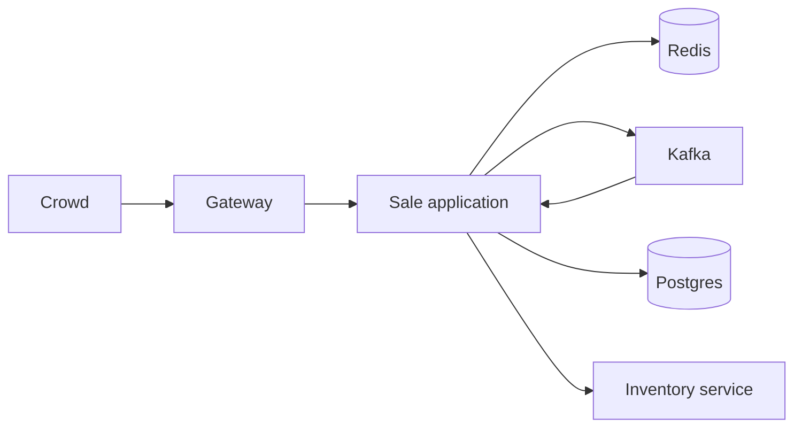
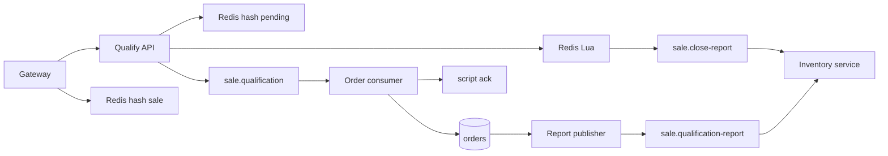
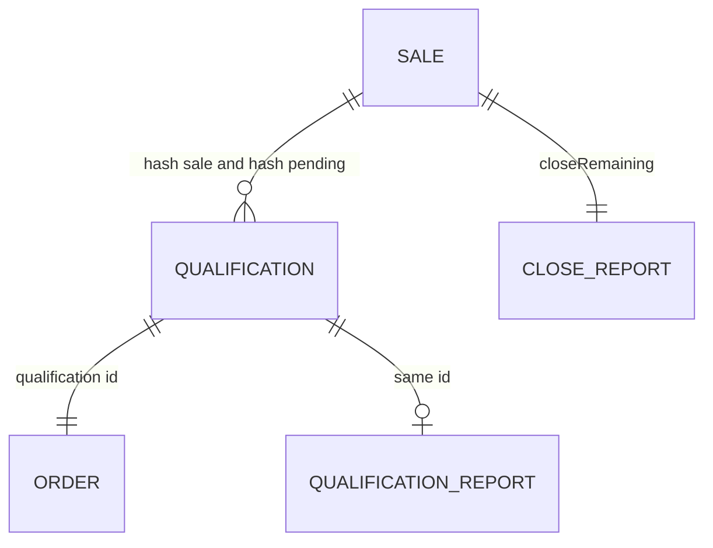
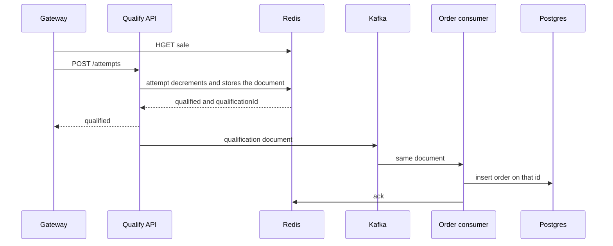

# Architecture Spine — Seckill hot-path

## Design Paradigm

Hot-counter qualification. One Redis Lua script decides the pool. The sale application answers from that script. Kafka carries the qualification document. Postgres stores one order per id. A read of sale state is `HGET` on the sale hash. It does not run the script.



## Invariants & Rules

### AD-1 — Atomic pool script [ADOPTED]

- **Binds:** FR-3, FR-4, FR-5, FR-6, FR-8
- **Prevents:** two writers of the remaining count, a Postgres decrement on the attempt, a gateway that answers `closed` and `not_open` from a different encoding, and a qualification id that exists only in process memory
- **Rule:** Redis hash `sale` holds `itemId`, `allotment`, `remaining`, `open`, `closed`, `soldOut`, and `closeRemaining`. `open`, `closed`, and `soldOut` are `0` or `1`. `closeRemaining` is absent until the first close. Hash `pending` holds one qualification document per field, and the field name is `qualificationId`. The script is the only writer of `sale`, and the only writer that adds a pending field. Commands are `load`, `start`, `attempt`, `close`, and `ack`. `load` runs only when `open` is `0` and `closed` is `0`. It sets `itemId`, `allotment`, `remaining` equal to `allotment`, and `soldOut` to `0`. `allotment` does not change after that. `start` runs only in that same state, sets `open` to `1`, and does not change `remaining`. `attempt` answers without a decrement and without a new id when the answer is `unidentified`, `closed`, `not_open`, or `sold_out`. The decrement that takes `remaining` from 1 to 0 sets `soldOut` to `1` in that same execution and still returns `qualified`. `close` sets `closed` to `1` and stores `remaining` into `closeRemaining` only when that field is absent. It does not change `remaining` or `allotment`. `ack` deletes one pending field and changes nothing else. The script keeps no per-customer cap, cooldown, or prior-qualification set. The same `userId` may take another unit on a later attempt while a unit remains. Postgres is not read to decide the attempt.

### AD-2 — Deployables [ADOPTED]

- **Binds:** FR-5, FR-6, FR-7, FR-11
- **Prevents:** the gateway and the sale application choosing different admission rules, a third service owning the order insert, packages added to the previous Modulith tree, and one of the two processes staying on Java 17 or on WebFlux
- **Rule:** Two deployables. `sale` and `gateway` are new Gradle subprojects and new Boot jars. Root `build.gradle` keeps `languageVersion = JavaLanguageVersion.of(17)` for the existing `src/` tree. `sale/build.gradle` and `gateway/build.gradle` each set `languageVersion = JavaLanguageVersion.of(21)`. No `allprojects` or `subprojects` toolchain assigns one language version to the root and those two projects. Both new processes set `spring.threads.virtual.enabled=true` and `spring.main.keep-alive=true`. They do not depend on `spring-modulith`, `namastack-outbox`, or `spring-boot-starter-webflux`. The existing `src/` tree is the previous service and is not extended. The gateway is the edge. The sale application hosts the qualify API, the Kafka consumer that inserts orders, and the publisher of qualification reports. Many sale instances share one Redis and consumer group `sale-qualification`.

### AD-3 — Dependency direction [ADOPTED]

- **Binds:** all
- **Prevents:** the qualify path importing the order writer, the report publisher inserting an order or publishing the close report, and the sale application calling the inventory service on the attempt
- **Rule:** The gateway may call `POST /attempts` and may `HGET` hash `sale`. It does not `EVAL`. The qualify API may run the script and may publish `sale.qualification`. The order consumer may read that topic, insert into `orders`, and then call `ack`. The report publisher may read an `orders` row and publish `sale.qualification-report`. It does not insert an order and does not publish `sale.close-report`. Only the `close` command publishes `sale.close-report`. The inventory service is outside this repo. The attempt response returns before any inventory call.



### AD-4 — Qualification document [ADOPTED]

- **Binds:** FR-7, FR-9, FR-11
- **Prevents:** a retry creating a second order, a bare id that the order insert cannot turn into a row, and a lost decrement with no document to recover
- **Rule:** One qualification document is JSON with exactly `qualificationId`, `saleId`, `userId`, and `itemId`. `qualificationId` is a lowercase UUID, 8-4-4-4-12, from the first 32 hex digits of `redis.sha1hex` of `userId`, `remaining`, and `TIME`, built inside the script. `saleId` is the string `sale`. `itemId` is the loaded `itemId`. Storing `userId` on that document is not a per-customer set. The script writes the document into hash `pending` in the same execution as the decrement. The `sale.qualification` key is `qualificationId`. The value is those JSON bytes, with no schema-registry envelope. The relay republishes that value while the field remains. Table `orders` is Flyway. Its primary key is `qualification_id`. Columns `sale_id`, `user_id`, and `item_id` are not null. The order consumer is the only inserter. The insert is idempotent on that primary key. It calls `ack` only after the insert commits. It does not commit the Kafka offset past an insert that did not commit. Until the row exists, that unit is not granted again. A qualification id with no order row fails the build. The attempt response is sent before the publish.

### AD-5 — Broker [ADOPTED]

- **Binds:** FR-7, FR-9
- **Prevents:** one builder publishing to Kafka and another to RabbitMQ, and a second meaning of `remaining` on the qualification report
- **Rule:** The broker is Kafka. RabbitMQ is not used. Topic `sale.qualification` carries the qualification document. Topic `sale.qualification-report` carries one qualification report, body exactly `qualificationId`, `saleId`, `userId`, and `itemId`, key `qualificationId`. Topic `sale.close-report` carries the close report, body exactly `saleId`, `itemId`, and `remaining`, key `saleId`. `remaining` there is `closeRemaining`. Units still in `pending` are not remaining. The three topics are created the way `kafka-init` creates topics: replication factor 1, one partition. `inventory.order-accepted` belongs to the previous service.

### AD-6 — Answers and the edge [ADOPTED]

- **Binds:** FR-4, FR-5, FR-8
- **Prevents:** the gateway and the sale application returning different answer names, a sold-out or closed attempt reaching a decrement, and a read that runs the script
- **Rule:** The attempt is `POST /attempts` with JSON body exactly `userId`. Every attempt response is HTTP 200. The body is exactly `answer`, plus `qualificationId` only when `answer` is `qualified`. `userId` is unidentified when it is absent, empty, or whitespace only. Any other `userId` is forwarded unchanged. Answer order, in the gateway and in the script: unidentified, then `closed` when `closed` is `1`, then `not_open` when `open` is `0`, then `sold_out` when `soldOut` is `1` or `remaining` is `0`, then the script decrements. The gateway applies that order from `HGET` and does not call the sale application when it can answer. The script applies the same order when an attempt arrives. The gateway is `spring-cloud-starter-gateway-server-webmvc` at the Spring Cloud 2025.1.3 BOM, on embedded Tomcat. WebFlux is not used. A CDN in front of the gateway is a production placement and is not a second filter in this learning model. A read of whether the sale is open, whether it is sold out, or how many units remain is `HGET` on hash `sale`.

### AD-7 — Downstream protection [ADOPTED]

- **Binds:** FR-10
- **Prevents:** a breaker around the Lua script, a shed qualification report, a failed export granting another unit, and the gateway breaker wrapping the attempt
- **Rule:** The sale application depends on `spring-boot-starter-webmvc` and `spring-cloud-starter-circuitbreaker-resilience4j` at the 5.0.3 BOM. The gateway uses that same breaker starter when it protects a route, and it does not depend on `spring-cloud-starter-circuitbreaker-reactor-resilience4j`. An open breaker may shed telemetry export only. The report publisher retries `sale.qualification-report` until the producer ack. A failed publish leaves that order eligible on the next pass. The order insert is retried by the relay until the row exists. The breaker does not skip the Lua script, does not decrement again, and does not stall the script. The attempt response returns from the Lua result and does not wait on telemetry export. The gateway breaker does not wrap the forward of `POST /attempts`.

### AD-8 — Sale lifecycle [ADOPTED]

- **Binds:** FR-1, FR-2, FR-9
- **Prevents:** a second load changing an open pool, and two publishers of the close report
- **Rule:** The inventory service calls the sale application directly. `POST /sales/load` body is `itemId` and `allotment`, and `allotment` is an integer zero or greater. `POST /sales/start` and `POST /sales/close` bodies are empty objects. An applied command is HTTP 200. A `load` or `start` the script refuses is HTTP 409 and changes nothing. These responses are not the five attempt answers. A load while the sale is open does not change the pool. `close` stops further decrements by setting `closed` to `1`. A second close republishes the stored close body.

### AD-9 — Telemetry [ADOPTED]

- **Binds:** FR-11
- **Prevents:** a collector failure changing who qualified, a second metrics stack, and an order log that omits the qualification id
- **Rule:** The sale application and the gateway export traces, metrics, and logs to `http://localhost:4318/v1/traces`, `http://localhost:4318/v1/metrics`, and `http://localhost:4318/v1/logs`, sampling probability 1. Prometheus keeps scraping `otel-collector:8889`. Grafana keeps the existing Prometheus datasource. The sale application owns the sale panels. A down collector does not change the Lua result. Logs name the answer and, for `qualified`, the qualification id. The order-insert log includes that id.

### AD-10 — Local runtime [ADOPTED]

- **Binds:** FR-6, FR-11
- **Prevents:** a second broker, a new OTLP port, Redis on a different host, and a direct Prometheus scrape of the application
- **Rule:** This learning model is the existing `compose.yaml` plus one Redis service `redis:8.10.2` on port 6379. `sale` and `gateway` are local processes on that network, started by hand, on the Java 21 toolchain in AD-2. The root toolchain that compiles `src/` stays Java 17. JDBC is `jdbc:postgresql://localhost:5432/flashsale`. Kafka is `localhost:9092`. Redis is `localhost:6379`. The Boot Gradle plugin stays 4.1.1 and wins over the Cloud BOM property that records Boot 4.0.8. `kafka-clients` stays the 4.2.1 the Boot BOM manages.

## Consistency Conventions

| Concern | Convention |
| --- | --- |
| Naming | Packages `qualify`, `order`, `report` inside the sale application. Topics and the consumer group are the names in AD-5 and AD-2. Answers are the five strings in AD-6. |
| Data and formats | The qualification document, the qualification report, and the close report are the bodies in AD-4 and AD-5. Customer id and item id are exact strings. Units on a qualification are the integer 1. |
| State and cross-cutting | One open sale. `saleId` is `sale`. The edge forwards `userId` and does not authenticate. Clock is the inventory service's start and close calls. |
| Build | Gradle. JaCoCo stays at 95% line and 95% branch on `sale` and `gateway`. Tests cover FR-1 through FR-10, including two sale instances against one Redis. The build fails when a qualification id has no order row and when those tests fail. |

## Stack

| Name | Version |
| --- | --- |
| Java for sale and gateway | 21 |
| Java for the previous service | 17 |
| Spring Boot | 4.1.1 |
| Spring Cloud | 2025.1.3 |
| spring-cloud-starter-gateway-server-webmvc | 5.0.3 |
| spring-cloud-starter-circuitbreaker-resilience4j | 5.0.3 |
| Resilience4j | 2.3.0 |
| Spring Kafka | 4.1.1 |
| kafka-clients | 4.2.1 |
| Apache Kafka image | 4.3.1 |
| PostgreSQL | 18.6 |
| Redis image | 8.10.2 |
| OpenTelemetry collector | 0.162.0 |
| Prometheus | 3.15.0 |
| Grafana | 13.2.3 |

## Structural Seed

```text
sale/                 # qualify API, order consumer, qualification-report publisher
gateway/              # Spring Cloud Gateway process
compose.yaml          # existing file, plus the Redis service
```





## Capability → Architecture Map

| Capability | Lives in | Governed by |
| --- | --- | --- |
| FR-1, FR-2 | `load`, `start`, `close` | AD-1, AD-8 |
| FR-3, FR-4, FR-6 | `attempt` | AD-1, AD-4 |
| FR-5 | Gateway `HGET`, then `attempt` | AD-6 |
| FR-7 | Hash `pending`, Kafka, `orders` | AD-4, AD-5 |
| FR-8 | `HGET` on hash `sale` | AD-1, AD-6 |
| FR-9 | Report publisher, and `close` for the close report | AD-3, AD-5, AD-8 |
| FR-10 | Circuit breaker in the sale application | AD-7 |
| FR-11 | Existing collector, Prometheus, Grafana, JaCoCo | AD-9, AD-10 |

## Deferred

- CDN vendor, cache keys, and TLS. The gateway is the filter this learning model runs.
- No numeric admission rate is asserted. The gateway may throttle. The sale path still answers from the hash and the script.
- The inventory service's internal stock posting. This spine defines the two Kafka reports.
- More than one open sale.
- Returning a unit when payment does not finish.
- A sale clock inside this service.
- A hosted provider, process supervision, health checks, and alerting. Revisit when `sale` and `gateway` are no longer started by hand.
